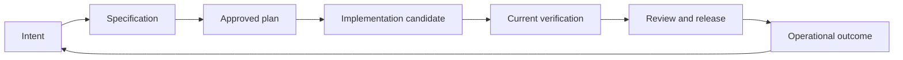

# Controlled Development

The optional local desktop candidate has readable forms for the later Build,
Verify, Review & release and Maintain artifacts. Use Project checks for actual
verification and invariant runs; recording an artifact or observation cannot
replace their current receipts. Human evidence and independent review have
separate record forms and explicit previews. A review by the candidate's own
implementer remains rejected by Core. Local actor labels are not authenticated
people. Manual deployment reports remain self-reported.

Current plan/candidate/release references are reused. Retained references that
differ from the current record show drift and require deliberate review. Inspect
exact identities and optional protocol JSON in advanced panels. Drafts survive
navigation; save or explicitly discard before changing their scope. A successful
operation acknowledges only its submitted draft, retaining unrelated edits.

ControlCoding records each software change as a versioned development path:
intent, specification, approved plan, implementation, verification, review and
release, and operational outcome. This is an experimental development candidate.
The Core service owns the records and evaluates the gates; the desktop page
displays the same results. Opening either view does not activate the method.

## Method and ownership

`development method` returns the implemented method identity, semantic version,
evaluator version and digest. Every change retains its creation method identity. Unknown methods
or schemas fail closed; changing the method requires an explicit supported
migration rather than reinterpretation of old approvals.

The current candidate implements method **0.11.0**. Migration is explicit and
follows the exact supported predecessor identities through the compatibility
chain, including retained CD10/PW00 and Product workflow methods. Unknown pairs
remain unsupported. Preserve each original registry and matching implementation;
do not edit method identities to make an old registry appear current. Retained
approvals remain historical where current execution evidence is required.

The registry is logically `.controlcoding/development.json`. Contained projects
route it through their existing layout. Its schema 2 manifest references immutable
objects in `.controlcoding/development/objects/`. The logical service response
retains schema 1. Decisions reference exact artifact revisions and upstream
versions. A source candidate identifies selected files by path, size and SHA256
and binds the intent, specification, plan and method.

The manifest is limited to 2 MiB and individual objects to 256 KiB. Separate
planning session heads do not advance the control revision. Sessions retain up
to 64 turns and 256 KiB each; retained planning objects share a 64 MiB quota.
Control writes do not consume this planning quota. Adding planning data uses a
conservative scan bounded to 32,768 physical objects and 128 MiB across the
retained store, including unreferenced objects. That inspection budget can block
new planning data before the planning quota is full. Restoring control data with
no new session-head bytes does not require a planning-capacity scan.
History is retained without
automatic deletion. Checkpoints move replay entries and original events into
immutable indexed objects. Current writes and checkpoints keep at most 2,048 hot
replay entries; ordinary commits compact earlier to bound working tails. Exact
migration preserves the predecessor ledger until checkpoint or the next ordinary
commit, including a supported 0.6.0 ledger above 2,048 entries. Cold retry lookup has
a finite traversal budget and fails closed when lookup is incomplete or corrupt.
This does not provide indefinite capacity.

## Explicit historical migration

```powershell
python scripts/cc_development_compatibility.py --project-root .
python scripts/cc.py development migration-preview --project-root . --json
python scripts/cc.py development migrate --project-root . --revision SOURCE_REVISION --approval-id APPROVAL_ID --actor maintainer --json
```

The standalone inspector reads the old state without importing the current Core.
Preview validates the original history and observes unfinished external effects.
Migration rechecks both under the publication lock and preserves the exact
original bytes in its archive. Change identities and historical decisions remain
unchanged. Compatible intent, specification and plan decisions retain their
applicability; later stages require current checks and renewed acceptance under
the installed owner. Unknown identities and unfinished effects block migration.
Upgrading retained 0.6.0 preserves its exact original manifest, referenced state
and any existing CD10 archive chain. Replaying the original reviewed migration
does not create another migration record.
Run checkpoint preview/apply after migration to compact the retained predecessor
ledger before continuing ordinary work.

## Retained history and checkpoints

```powershell
python scripts/cc.py development checkpoint-preview --project-root . --json
python scripts/cc.py development checkpoint --project-root . --revision CURRENT_REVISION --approval-id APPROVAL_ID --actor maintainer --json
python scripts/cc.py development history CH-01 --project-root . --limit 64 --json
```

Checkpoint applies the exact preview under the publication lock, stages durable
immutable objects, and publishes the replacement manifest last. Its retained
receipt supports the same reviewed retry; another actor or changed revision
cannot reuse that approval. Checkpointing does not approve a stage or revive
obsolete evidence.

Normal status and desktop reads return current artifacts, gates and a recent
history tail. `history_retention.partial` explicitly marks checkpointed history;
`retained_records` includes cold originals. These reads are not the complete
historical event list. The history command returns original events with their
original digests, not reconstructed validation records. Reuse its returned
cursor as a JSON argument, for example
`--cursor '{"revision":"CURRENT_REVISION","offset":64}'`, to read the next page.
Cursors bind the committed
revision; a concurrent mutation requires restarting inspection with a new cursor
for the current revision.

Backup holds the same publication barrier and includes every referenced control,
session, cold replay, history, checkpoint source and predecessor archive object.
Detached validation checks the full closure before restore publication. The
archive has an explicit 192 MiB limit and object traversal limits; exhaustion
blocks export instead of omitting history. Quotas do not guarantee physical free
disk space. Interrupted restore retains a journal; after native writer death,
review a fresh restore preview before retrying the same archive. No retained
objects are automatically deleted.

Local actor labels remain unauthenticated provenance. Hashes detect inconsistency
against retained objects; they are not signatures against an actor replacing all
trusted local bytes.

The local planning session API is available in `cc_development_sessions` for
`create`, `append` and `read`. It uses separate session revisions, exact operation
replay and the Core publication lock. These are storage capabilities; the guided
Project Document and discussion pages are a subsequent product increment.

The existing Planner, feature registry and verification owners remain separate.
The development service references their results instead of replacing them.
Legacy feature `passing` is not evidence that the development path is approved.
Memory and desktop projections are not approval authorities.



Each transition needs the preceding accepted artifacts and current gate results.
Changing an upstream artifact invalidates downstream approvals. Changing source
bytes makes the candidate stale. Implemented, verified, approved and observed
release remain separate outcomes.

## Start a change

From a source checkout, use the actual CLI entrypoint:

```powershell
python scripts/cc.py development status --project-root . --json
python scripts/cc.py development method --project-root . --json
python scripts/cc.py development init --project-root . --profile standard --json
python scripts/cc.py development create CH-01 --title "Improve checkout recovery" --owner maintainer --risk standard --project-root . --json
python scripts/cc.py development show CH-01 --project-root . --json
```

`init` and `create` are explicit writes. Read commands neither initialize memory
nor create records. The project profile sets a minimum; a change can select a
higher risk profile. The method response is the authority for supported policy.
Do not infer that a profile name proves production authorization.

In the desktop Development page, select the project, activate the method, create
a change and fill its intent, specification and plan. Preview shows effects,
blockers and the proposed gate results. Confirm commits the preview held by the
main process. Changing projects or refreshing a stale revision requires a new
preview. Advanced operations use the same typed action contract.

## Artifacts and decisions

`development method` lists the exact fields for each stage. Intent records the
problem, intended outcome, affected users, constraints, exclusions, unresolved
questions and success measures. Specification gives stable requirement and
criterion IDs, decisions, risks, policy concerns and source references. The plan
binds the specification revision and lists files, ownership, tasks, dependencies,
criterion mapping, verification strategy and rollback assessment.

A criterion has this shape:

```json
{
  "id": "AC-01",
  "requirement_id": "REQ-01",
  "text": "Retry preserves the user's cart",
  "required": true,
  "proof": "automated",
  "checks": [{"kind": "verification", "id": "checkout-regression"}]
}
```

Proof is `automated`, `human` or `both`. Automated checks refer to current
required entries of the existing verification or invariant contracts. An
arbitrary successful command cannot satisfy a criterion. Human observations
remain reported evidence until separately accepted for the exact candidate.

Store a typed action in a JSON file outside the source tree. For example:

```json
{
  "kind": "decide",
  "change_id": "CH-01",
  "stage": "intent",
  "decision": "accepted",
  "actor": "maintainer",
  "reason": "The outcome and exclusions are clear"
}
```

Preview and apply it using the returned revision and approval ID:

```powershell
python scripts/cc.py development preview --project-root . --action-file ACTION.json --json
python scripts/cc.py development apply --project-root . --action-file ACTION.json --revision REVISION --approval-id APPROVAL_ID --json
python scripts/cc.py development check CH-01 --stage plan --project-root . --json
```

`check` exits successfully only for a currently allowed gate. `apply` rejects a
different action, project identity, revision or gate assessment. Repeating an
already completed identical operation returns an idempotent receipt. Actor
names are local labels, not authenticated identities. The service requires a
different actor label for independent verification and review decisions; this
does not prove that two different people participated.

## Execution and current evidence

An approved plan can produce a manual host handoff. Execution by another coding
tool is reported work until source and proof are observed by their owners.
Existing AI role responses are proposals and cannot accept an artifact.

```powershell
python scripts/cc.py development handoff CH-01 --project-root . --json
python scripts/cc.py development bindings CH-01 --feature-id F-01 --project-root . --json
python scripts/cc.py verification status --project-root . --json
python scripts/cc.py invariants status --project-root . --json
```

The verifier reads canonical latest receipts and their current input identities.
A newer failed, partial, stale or malformed attempt cannot uncover an earlier
passing result. Review findings and unresolved failures remain visible. Major
or critical unresolved review findings block release.

## Explicit environment adapters

Project adapters are opt-in declarations in the logically routed
`.controlcoding/development-adapters.json`. Each declaration fixes an ID, kind,
argument vector, time and output limits, pinned project files and configuration.
The command implementation and resolved executable are hashed in the preview.
Shell entrypoints and inline interpreter code are refused. Configured commands
run with the user's privileges; these bounds do not sandbox program behavior.

Supported job kinds are `agent_eval`, `release_status`, `deploy`, `rollback`,
`monitor`, `pull_request` and `diagnosis`. Preview is read-only; execution requires its exact approval ID:

```powershell
python scripts/cc.py development job-preview CH-01 --kind agent_eval --adapter-id eval-suite --project-root . --json
python scripts/cc.py development job-run CH-01 --kind agent_eval --adapter-id eval-suite --approval-id APPROVAL_ID --project-root . --json
```

Results are retained as canonical job receipts. A supplied JSON body claiming
`observed_command` cannot establish an observation without its matching retained
receipt. Evaluation binds configuration, task set, grader and candidate and
requires every declared case. Release observations bind the approved artifact,
environment and exact local Git base and head. Manual prepared and self-reported
release records are visibly weaker than observed release records.

Monitoring compares a declared release and observation window with configured
baselines, minimum sample counts and thresholds. Explicit capture retains the
canonical monitor receipt and latest observed release receipt. Breaches become
persistent incidents grouped by parent, release, environment, window and metric.
Each distinct receipt contributes one occurrence. Replaying a captured receipt
preserves its historical facts without inventing a new occurrence or claiming
current health. New occurrences require a fresh revision-bound owner decision.

Operational observations bind the exact candidate and most recent release
record. Replacing the release requires new observations. Declared monitor signals
must resolve to current canonical assessments: missing data, disconnection or a
threshold breach blocks closure. After a healthy recovery, retained incidents
still need an explicit disposition. An owner decision records responsibility
and cannot override missing or unhealthy monitoring. Legacy maintenance proposals
remain readable through existing artifact dispositions; canonical incidents have
their own retained decision history.

For the same monitor adapter and observation window, the newest attempt
supersedes earlier proof, including a failed or running attempt. An earlier
healthy receipt cannot cover a later disconnection merely because that failed
attempt has not been captured into the registry.

Legacy evaluation declarations with `configDigest`, `taskDigest`, `graderDigest`
and `requiredCases` remain readable and executable. Their worker-reported pass
flags do not qualify automation. Version 2 evaluations use representative tasks
and expected outcomes graded by the trusted ControlCoding owner; see the
evaluation procedure below. No autonomous coding host is currently enabled by
these evaluation results.

An adapter may declare a bounded `attemptToken` to request a separately reviewed
attempt. Replaying the same approved job returns its retained completion. A
retained running attempt after interruption blocks repetition: the tool cannot
assume that an external deployment failed before taking effect.

## Operational incidents and linked intent drafts

Use `development preview` and `development apply` with the same typed action
contract as other reviewed changes. The desktop page exposes these actions as
capture, owner decision and linked follow-up controls, including for closed parents.

```json
{
  "kind": "incident_capture",
  "change_id": "CH-01",
  "receipt_id": "development_job_0123456789abcdef0123456789abcdef",
  "signal_id": "MONITOR-01",
  "actor": "operations-reviewer",
  "reason": "Retain the observed window and review any breach"
}
```

`receipt_id` must identify an actual sealed canonical monitor job. `signal_id`
is the stable maintenance signal label; capture retains all configured metrics
from the receipt. The monitor configuration must name the release environment.
Supplied observation bodies, unknown values, missing citations
and superseded attempts cannot introduce an observed incident. Both monitor and
release receipts, project, method, source candidate and configured rules are
retained with the facts. Historical captures remain readable after later drift.

An `incident_decide` action supplies `change_id`, the canonical `incident_id`,
`decision` (`resolved`, `rejected` or `deferred`), `owner`, `actor` and `reason`.
The preview binds the current incident revision. An `incident_followup` action
supplies the parent `change_id`, `incident_id`, new `child_id`, `title`, `owner`,
`risk`, `actor` and `reason`. One transaction creates the child and its intent
draft, records the parent's decision and links their histories. Each incident
can create one linked child; its risk cannot fall below the parent's profile.
No intent, specification, plan or implementation approval is created. Later
occurrences retain the link and require a fresh owner decision.

A closed parent's original cycle stays closed. Its operational records and
linked drafts can evolve without modifying its accepted artifacts. The incident
view distinguishes retained facts from current monitoring and does not claim
that an earlier healthy observation proves present production health.

## Bounded diagnosis

A `diagnosis` adapter fixes `argv`, executable and file pins, output limit and
timeout. Its configuration is `{ "incidentId": "CANONICAL_HASH", "mode": "deterministic" }`.
Use exactly one `{diagnosisRequest}` argument: execution writes the bounded
request to a managed local file and substitutes its path. The request includes
captured event identities and a bounded source snapshot, rather than arbitrary
renderer text. Preview and `job-run --approval-id` explicitly delegate that
configured command; preview does not run it.

Agent mode additionally requires pinned `configurationPath` and `evaluationId`.
Its exact configuration must pass the current independently graded version 2
evaluation. Qualification does not authorize applying a diagnostic suggestion.

```powershell
python scripts/cc.py development job-preview CH-01 --kind diagnosis --adapter-id incident-reader --project-root . --json
python scripts/cc.py development job-run CH-01 --kind diagnosis --adapter-id incident-reader --approval-id APPROVAL_ID --project-root . --json
```

Output must bind `schemaVersion: 1`, `requestDigest`, `incidentId` and
`incidentRevision`, and declare `outcome` as `reported` or `abstained`.
Each reported finding has `id`, `statement`, finite `confidence` from 0 to 1,
`hypothesis: true`, citations to captured event IDs and nonempty `proposedChecks`.
Uncited, oversized or unsupported claims fail closed. Findings remain hypotheses:
`causalCorrectnessVerified` is false. Core does not resolve an incident from a
report, apply a correction, deploy software or run recovery commands from findings.
These invocation bounds do not provide an OS sandbox. Current input drift and
newer failed attempts prevent an earlier report from qualifying as current.

## Representative agent evaluations

A version 2 `agent_eval` adapter uses this configuration:

```json
{
  "evaluationVersion": 2,
  "implementationActor": "Implementer",
  "graderActor": "Reviewer",
  "suitePath": "eval/tasks.json",
  "configurationPath": "eval/configuration.json"
}
```

Declare the suite, configuration, worker program and every configuration input in
the adapter's hashed `files` list. The fixed `argv` must contain exactly one
`{evalRequest}` placeholder, passed as the worker's request argument. The resolved
executable and installed deterministic grader are pinned by the controller.

The configuration file has `schemaVersion: 1`, an exact `model` object containing
`provider`, `id` and `revision`, an `inputs` list, and `budgets`. Each input has
`kind` (`prompt`, `skill`, `hook`, `model` or `adapter`), project-relative `path`
and `sha256`; it must match a manifest pin. Budgets declare `totalTimeoutSeconds`,
`caseTimeoutSeconds`, `maxCostMicros`, `maxInputTokens` and `maxOutputTokens`.
Use an explicit stable model revision, not an unidentified or moving alias.

A suite has `schemaVersion: 1`, `id`, `version` and one or more required `cases`.
For example, this case checks actual generated file content:

```json
{
  "id": "explain-progress",
  "prompt": "Write progress.txt explaining the missing security check.",
  "files": [{"path": "context.txt", "content": "Security verification is missing."}],
  "checks": [{"kind": "file_contains", "path": "progress.txt", "text": "security"}]
}
```

Checks support `file_contains` with `text`, `file_sha256` with `sha256`, and
`file_absent`. Choose checks that establish the task's expected outcome; a small
substring check alone cannot establish software correctness. Every case runs in
a separate retained directory. The request contains the prompt, declared model
and input file paths; expected checks are withheld. The worker writes files in
that directory and returns only a JSON object containing `model` and `usage`.
Usage fields are `costMicros`, `inputTokens` and `outputTokens`. Worker-reported
pass flags cannot replace deterministic grading of actual output bytes.

Model identity and usage are **adapter-reported**, not authenticated provider
observations. Time and output are bounded by the controller; token and cost
limits are assessed after each invocation and stop subsequent cases. They do not
prevent a provider from charging during the current invocation. Task directories
are not a sandbox. Commands retain the user's file and external-system access.
Implementer and grader names must differ but are not authenticated human roles.

The canonical receipt retains failed and unrun cases. Input drift, unexpected
model identity, missing usage, exceeded bounds, changed expected definitions or
changed output files block current qualification. A later failed attempt with the
same evidence ID supersedes the earlier successful attempt. New attempts require
a separately reviewed `attemptToken`; the controller never reruns interrupted
work automatically.

Attach the returned receipt and observation through the existing typed `evidence`
operation, using a stable record `id`, `kind: "agent_eval"`, `receiptId` and
`observation`. Both the CLI change view and desktop evaluation panel show the
current assessment. A read-only CI check can require the exact selection:

```powershell
python scripts/cc.py development eval-check CH-01 --evaluation-id EVAL-01 --configuration-digest CONFIG_SHA256 --project-root . --json
```

This command returns nonzero for missing, stale or failing qualification. It does
not execute a provider. Configure it as a required project verification/CI check
when agent qualification is required. Updating a pinned prompt, skill, hook,
model declaration, adapter, method or suite invalidates the old result and
requires a newly approved evaluation; evaluations are not implicitly rerun.
Automated build provenance must explicitly select `evaluation_id` and
`configuration_digest`. A successful evaluation applies only to that pinned
adapter and task suite. A controlled proposal can use that qualification through
the separately approved execution and application steps below.

## Controlled proposals and application

Method 0.3.0 adds a proposal worker and an application gateway. Neither a passing
evaluation nor an execution receipt applies project changes. The worker runs in
a separate retained directory; its returned files require a second approval of
the concrete diff. The current desktop view displays linked execution evidence
and application assessment; these execution operations use the CLI.

Declare the logically routed `.controlcoding/development-execution.json`:

```json
{
  "schemaVersion": 1,
  "adapters": [{
    "id": "proposal-worker",
    "kind": "proposal_worker",
    "argv": ["ABSOLUTE_PYTHON", "-B", "workers/proposal.py", "{request}"],
    "files": [
      {"path": "workers/proposal.py", "sha256": "WORKER_SHA256"},
      {"path": "eval/configuration.json", "sha256": "CONFIG_SHA256"},
      {"path": "eval/tasks.json", "sha256": "SUITE_SHA256"}
    ],
    "configurationPath": "eval/configuration.json",
    "evaluationId": "EVAL-01",
    "timeoutSeconds": 60,
    "outputLimitBytes": 65536,
    "maxInputTokens": 10000,
    "maxOutputTokens": 5000,
    "attemptToken": "attempt-1"
  }]
}
```

Replace example paths and hashes with reviewed values. The selected evaluation
must qualify this exact executable, program, argv and configuration. Its argv
uses `{evalRequest}` where execution uses `{request}`; other arguments must
match. Pins must be covered by the evaluated configuration. A configuration
change requires another evaluation, not a renamed adapter or copied receipt.

```powershell
python scripts/cc.py development execution-preview CH-01 --adapter-id proposal-worker --project-root . --json
python scripts/cc.py development execution-run CH-01 --adapter-id proposal-worker --approval-id EXECUTION_APPROVAL --project-root . --json
python scripts/cc.py development proposal-preview CH-01 --execution-id EXECUTION_ID --project-root . --json
python scripts/cc.py development proposal-apply CH-01 --execution-id EXECUTION_ID --approval-id APPLY_APPROVAL --project-root . --json
python scripts/cc.py development execution-status CH-01 --execution-id EXECUTION_ID --project-root . --json
python scripts/cc.py development execution-cancel-preview CH-01 --execution-id EXECUTION_ID --project-root . --json
python scripts/cc.py development execution-cancel CH-01 --execution-id EXECUTION_ID --approval-id CANCEL_APPROVAL --project-root . --json
```

Execution preview binds the accepted plan, existing and absent file baseline,
method, current qualification, configuration, executable, invocation and limits.
The worker returns one JSON object with `model`, `usage` and `files`, where each
file has `path` and complete UTF-8 `content`. The controller bounds time/output
and requires UTF-8 baseline files for this worker route; binary-file plans can
use the existing manual handoff. It
assesses reported usage and retains failed, cancelled and interrupted
attempts. A completed replay returns retained results; a new attempt requires a
changed, separately reviewed `attemptToken`. Cancellation records a request and
stops the controller's owned child; it does not guarantee termination of every
descendant or remote provider operation.

Application preview shows before/after hashes and diffs. Application admits only
planned files, safe paths and current source bytes, enforcing protected control
paths and the project's configured deny rules. Files are written individually
with durable write intent and observations. Application holds the Core registry
lock and reloads the accepted plan before checking its approval, so managed plan
edits cannot race source promotion. There is no all-files transaction:
partial application remains recorded, and recovery needs a freshly reviewed
preview. Recovery blocks a live, reused or unknown writer and unexpected source
bytes. After an abrupt process crash, first review and apply Core registry
recovery, then review proposal application recovery. Neither lock is silently
removed. This gateway does not support deletions or intercept uncooperative editor
writes; its cooperative lock is not an operating-system sandbox.

After application, explicitly capture the new candidate and attach typed evidence
with a stable `id`, `kind: "execution"` and the returned `receiptId`. A build
artifact selects the canonical proof:

```json
{
  "execution_provenance": {
    "mode": "controlled_proposal",
    "execution_id": "EXECUTION_ID",
    "apply_id": "EXECUTION_ID"
  }
}
```

The build gate requires the current plan, canonical execution and application
records, exact applied files, unchanged remaining baseline and current candidate.
Source or configuration drift blocks it. Successful proposal generation alone
does not establish application, verification, review or release. Historical
status remains inspectable after drift and is explicitly separate from current
qualification.

### Codex proposal worker

`cc_development_codex.py` is a standalone worker that can be deliberately copied
into an adopter's reviewed worker directory. Declare `kind: "codex_cli"`, pin that
copy, and use the same argv in evaluation and execution. It requires an absolute
native Codex executable with `--codex` and its hash with `--codex-sha256`, plus
explicit `--input-cost-micros-per-million` and
`--output-cost-micros-per-million` rates. The controller checks the copied worker
against its installed implementation. It never installs or activates Codex.

The worker uses non-interactive JSON events and structured output, with
`-a never`, `--sandbox read-only` and `--ephemeral`. Evaluation mode materializes
proposed files only in its retained case directory; execution mode returns a
proposal. These flags and events are documented in the official
[non-interactive guide](https://learn.chatgpt.com/docs/non-interactive-mode) and
[CLI command reference](https://learn.chatgpt.com/docs/developer-commands).
Local integration was checked against installed CLI 0.115.0; newer CLI flags are
not assumed.

Tokens come from the CLI completion event. Cost is a conservative estimate from
the configured rates, not a provider invoice; model identity/revision remains a
declaration, not provider attestation. The worker inherits the user's Codex
configuration and does not isolate plugins, credentials or all external access.
Local fake-process tests cover event parsing and the controller/gateway protocol.
A real native CLI/model qualification and host sandbox coverage require an
explicit representative evaluation on that host; they are not established by
these local tests.

## Observed pull requests and release packets

Method 0.4.0 can require a current observed GitHub PR before review and release.
Without the following policy, the existing manual, prepared and self-reported
paths remain available. With the policy present, every change requires an
explicit selection; a missing selection or malformed policy blocks the gate.
The logically routed `.controlcoding/development-release.json` contract is:

```json
{
  "schemaVersion": 1,
  "repository": "owner/repository",
  "baseRef": "main",
  "requiredChecks": [
    {"kind": "check_run", "name": "regression", "appId": 123},
    {"kind": "commit_status", "name": "security", "creator": "security-bot"}
  ],
  "requiredReviewers": ["responsible-reviewer"],
  "maxAgeSeconds": 300,
  "pullRequests": [
    {"changeId": "CH-01", "number": 42, "base": "EXACT_BASE_COMMIT", "headRepository": "owner/repository"}
  ]
}
```

Replace all example identities with reviewed actual values. At least one check
is required; `maxAgeSeconds` is 1 to 3600. The reviewer list may be empty when
the policy deliberately requires only checks. Use an exact 40-character
hexadecimal commit for the current GitHub reader, not a branch name. Its pure
request validator rejects unsupported provider repository and SHA formats
before invocation. Check names alone do not
identify their authority: check runs bind an app ID; commit statuses bind a
creator login. This policy declares local requirements. It does not reproduce
all GitHub branch protection or repository ruleset semantics.

Before observing the PR, the controller reads local Git through its confined
projection. HEAD and the base must exist locally, the base must be an ancestor,
and every candidate file must match the committed blob byte for byte. The
complete committed changed-file set must fit both the approved plan and the
candidate. Additional committed paths, deletions, renames represented as a
deletion/addition, submodules and symbolic links do not qualify. No fetch,
checkout, staging or commit is performed. This establishes selected source and
committed scope; it is not an attestation of every uncommitted build input.

The `pull_request` adapter uses a deliberately copied, byte-pinned installed
`cc_development_github.py` worker. Its fixed argv uses isolated Python (`-I -B`),
the literal `{pullRequestRequest}` argument, `--gh` with the reviewed absolute
native executable, and `--gh-sha256` with that executable's SHA256. Keep the
worker in the manifest's pinned `files`. Its configuration is empty, with an
optional reviewed `attemptToken` for a new observation. Arbitrary project
programs returning GitHub-shaped JSON cannot substitute for this reader.

The worker uses fixed REST GET routes on github.com, checks PR identity before
and after collection, and requires complete bounded pagination. It observes the
exact head repository/commit, check runs, commit statuses and reviews. Native
`gh` may read its configured credential store; the controller supplies no token
and never prints credentials. It neither changes the PR nor merges or deploys.
CLI identity relies on the reviewed executable and hash. The receipt is a local
command observation, not an independently authenticated remote attestation.
The endpoint contracts follow the official [GitHub CLI API documentation](https://cli.github.com/manual/gh_api),
[check runs](https://docs.github.com/en/rest/checks/runs?apiVersion=2026-03-10),
[commit statuses](https://docs.github.com/en/rest/commits/statuses?apiVersion=2026-03-10)
and [PR reviews](https://docs.github.com/en/rest/pulls/reviews?apiVersion=2026-03-10).

```powershell
python scripts/cc.py development job-preview CH-01 --kind pull_request --adapter-id github-reader --project-root . --json
python scripts/cc.py development job-run CH-01 --kind pull_request --adapter-id github-reader --approval-id APPROVAL_ID --project-root . --json
```

Select the returned canonical receipt in the review/release artifact using
`observation_provenance: {"mode":"github_pr","receiptId":"DEVELOPMENT_JOB_ID"}`.
The controller rechecks receipt integrity, installed reader/executable pins,
local Git, candidate, policy, PR identity and snapshot age. Missing, pending or
failed required checks, ambiguous histories, a wrong head, review dismissal or
requested changes block qualification. A later failed or unfinished attempt
prevents falling back to an earlier success. Remote state can change after this
bounded snapshot; the gate does not guarantee an atomic GitHub-to-deployment
transaction. Local reviewer actor labels still do not authenticate people.

After current verification and independent review, accept the exact
review/release artifact and prepare its target packet:

```powershell
python scripts/cc.py development release-preview CH-01 --observation-id DEVELOPMENT_JOB_ID --environment staging --artifact-digest ARTIFACT_SHA256 --project-root . --json
python scripts/cc.py development release-prepare CH-01 --observation-id DEVELOPMENT_JOB_ID --environment staging --artifact-digest ARTIFACT_SHA256 --approval-id APPROVAL_ID --project-root . --json
python scripts/cc.py development release-status CH-01 --packet-id RELEASE_PACKET_ID --project-root . --json
```

Preparation retains the exact candidate, approved review, verification evidence,
PR proof, environment and artifact. It does not deploy. A configured deployment
selects the packet with `--release-packet-id` on `job-preview` and `job-run`;
keep dynamic packet IDs out of the static adapter manifest. Bind the adapter's
`configuration.environment` and `configuration.artifactDigest` to the approved
target before executing effects. `{artifactDigest}` and `{environment}` may be
passed as fixed argument placeholders. `artifactDigest` names the desired
artifact after the operation. A live rollback from A to B requires its own
review and packet approving B, with `knownArtifactDigest` also equal to B; an
approval to deploy A does not authorize recovery to an arbitrary older artifact.
A rehearsal cannot establish an observed deployment.

Deployment and live rollback recheck canonical Core approval under its writer
lock before invoking the program. This serializes cooperative Core writers,
not all external Git or environment changes. Failed or interrupted external
effects remain uncertain; an explicit later `release_status` observation and
`--status-receipt-id` reconciliation precede a separately approved retry. No
automatic retry or autonomous recovery is granted. A configured program still
runs with user privileges; timeout cannot undo external effects.

The desktop shows current PR qualification, prepared packets and current
deployment assessment separately, with raw identities and checks collapsed.
Earlier observed releases remain history and do not establish a current release
after proof drift or a later failed attempt. Local process fixtures verify these
contracts; authenticated hosted GitHub reads and live deployment are separate
project-specific qualification steps.

## Critical change policy

Critical changes additionally read the logically routed
`.controlcoding/development-policy.json`. The exact contract is:

```json
{
  "schema_version": 1,
  "critical": {
    "approvers": {
      "technical": "Technical reviewer",
      "policy": "Policy reviewer",
      "environment": "Environment owner"
    },
    "security_checks": [{"kind": "verification", "id": "security-regression"}],
    "recovery_receipt": {"receiptId": "RETAINED_JOB_ID", "observation": {}}
  }
}
```

Replace the example receipt with a retained observed rollback rehearsal. The
three named approvers must be distinct from each other and the implementer.
Each explicitly accepts the exact review and release artifact. Policy edits
invalidate their decisions; missing required security proof or unobserved
recovery blocks the critical gate. These are local labels, with no enterprise
identity authentication. Unsupported policy exceptions fail closed; this
version has no waiver mechanism.

A rollback adapter configured for a rehearsal may run after current verified
work and binds the declared environment and known artifact. This permits proof
before production authorization. Ordinary deployment and live rollback keep
their separate release approval requirement. Neither grants autonomous recovery.

## Recovery and backup

Interrupted writers leave a lock and normal operations report
`recovery_required`. `recovery-preview` inspects the recorded operating system
process. An active, reused, inaccessible or unidentified owner cannot be removed
by this route. Apply the returned `recover` action, revision and approval ID only
after inspecting the preview. An ownerless early crash remains an administrative
recovery case; reads do not guess that a writer has finished.

```powershell
python scripts/cc.py development recovery-preview --actor maintainer --reason "Writer terminated" --project-root . --json
python scripts/cc.py development backup --project-root . --json
python scripts/cc.py development restore-preview --archive-file BACKUP.json --actor maintainer --reason "Restore retained history" --project-root . --json
python scripts/cc.py development restore --archive-file BACKUP.json --actor maintainer --reason "Restore retained history" --approval-id APPROVAL_ID --project-root . --json
```

Save backup output in the dedicated workbench. Restoration validates the full
history, method and original project identity and only writes an absent registry.
It cannot overwrite an active registry or import another project's approvals.
Schema 2 backups include the referenced object closure, planning sessions and
exact predecessor archives. Backup holds the publication lock while collecting
these roots. An interrupted schema 2 restore leaves a pending marker; normal
operations report `restore_recovery_required`. Retry the reviewed restore with
the same archive to finish publication. A different archive cannot take over
that pending restore. If the process also left a writer lock, request a new
restore preview: it can bind the observed dead writer to the reviewed recovery.
An active or unknown writer still blocks recovery. The pending marker must not
be deleted by hand.
Current source and evidence gates are reevaluated after restoration. Cross-project
history rebinding and shared authenticated approvals require a separate migration
contract.

## Scope and verification

The implementation controls its own records and registered command invocation.
It does not intercept every write made by an editor, authenticate reviewers,
connect a provider automatically, or configure a production environment merely
by activating a project. Protected host hooks retain their existing contract.

The required `controlled-development-regression` suite covers the service,
adapters, CLI and isolated transport. Desktop state and interaction checks are
part of the optional UI build checks. Production adoption, hosted PR checks,
real deployment credentials and a comparison with another method require
separate observed integrations and project-specific acceptance.
